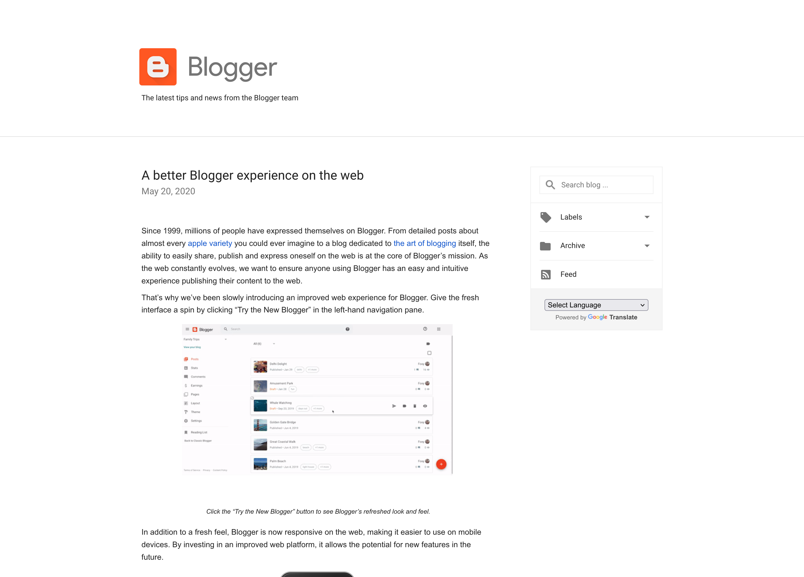
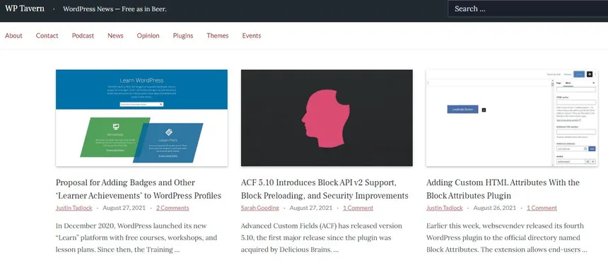
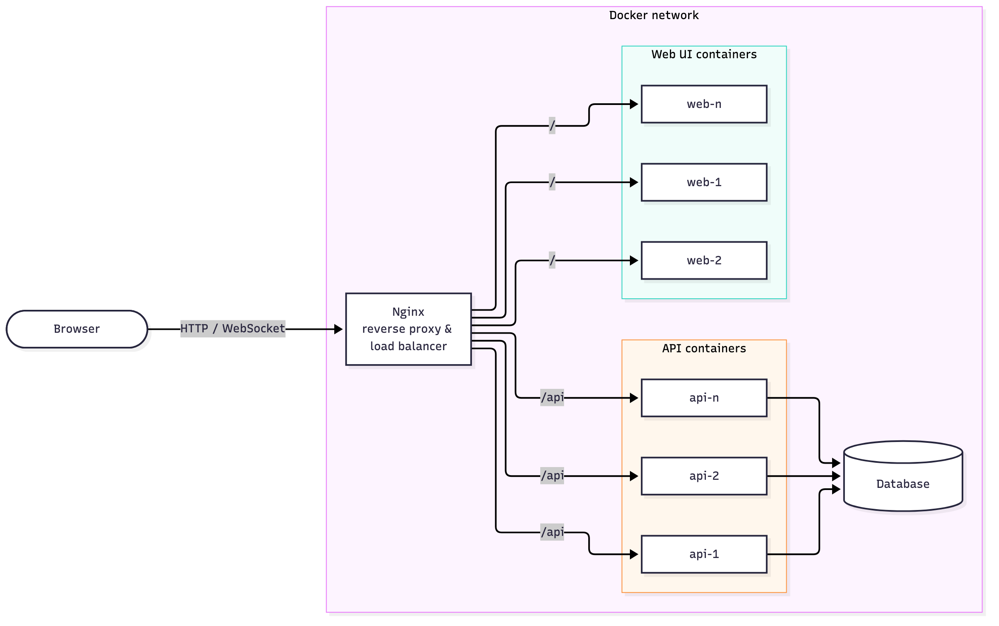

## Links

**GitHub Repository:**
[github.com/bobbymannino/comp3006](https://github.com/bobbymannino/comp3006)

**YouTube Video:** _TODO_

## Introduction

The project I have decided to pursue is making a blog. The functionality of the
blog is as follows:

- Anybody can create an account
- Users can edit/delete their own accounts
- Users can create/read/update/delete their own posts
- Users can like their own and other peoples posts
- Users can publish/unpublish their posts
- On each posts page there will be a live visitor count

Because I have prior knowledge in this specific field (web/API/database), I do
not have a priority list for the features. I am confident I can deliver all the
features to a high standard on time.

The product shall be called **Bloggy**.

## Target Audience

There is no specific demographic or user base in mind for this project, it is
designed for any user. A high priority for this project is **usability** and
**efficiency**. I would like the people who use this to know instantly without
any training or documentation how to use the product, as well as the product
feeling fast to use.

## Existing Products

There are several existing products that provide similar functionality to this
project. Some of the most popular ones include:

### [Blogger](https://www.blogger.com/)

{width=500px}

I have not used Blogger in over 5 years, but when I was using it for school it
got the job done. I will take inspiration from Blogger from a UX perspective,
keeping things simple and easy to understand was and is Bloggers best feature.

### [WordPress](https://wordpress.org/)

{width=500px}

I've never used WordPress before, but I know it has a massive market share
online. I also know it's more than a blog; it can do nearly anything, including
customizing the look. That customization is beyond this project's scope. I'll
use WordPress's complexity as a warning: there are many plugins, and while they
help, they can be overwhelming for someone wanting a straightforward public
blog.

### Existing Products Comparison

| Product   | Advantages                                                                   | Disadvantages                                                                        |
| --------- | ---------------------------------------------------------------------------- | ------------------------------------------------------------------------------------ |
| Blogger   | • Simple, easy to understand UI • Free • No setup or hosting needed    | • Limited customisation • Dated look • Few updates or new features             |
| WordPress | • Huge market share and community • Highly customisable • Many plugins | • Overwhelming for simple blogs • Plugins add complexity • Self-hosting needed |
| Bloggy    | • Simplest UI/UX • Performant                                             | • No extensions • Less features • Tiny userbase                                |

Table: Existing Products Comparison

## Architecture

### Architecture Topology

The product will follow a microservices architecture. There will be 4 Docker
images in this project:

- Nginx
- Database
- API
- Web UI

Each one runs independently and communicate with each other, for instance to
access the database you must use the API, to use the web UI you must use the
Nginx server. Putting the API and Web UI into their own containers allows you to
scale them independently and update them separately. If traffic becomes API
heavy you can scale those up, or if the user wants to host the API without
having any UI they can do that without any changes to the API container.

{width=500px}

> [!NOTE]
> Whilst it is possible to have multiple databases (read replicas) that is out
> of scope for this project so it will remain a single container.

### Nginx

_TODO_

### Web UI

_TODO_

### Database

_TODO_

### API

_TODO_
