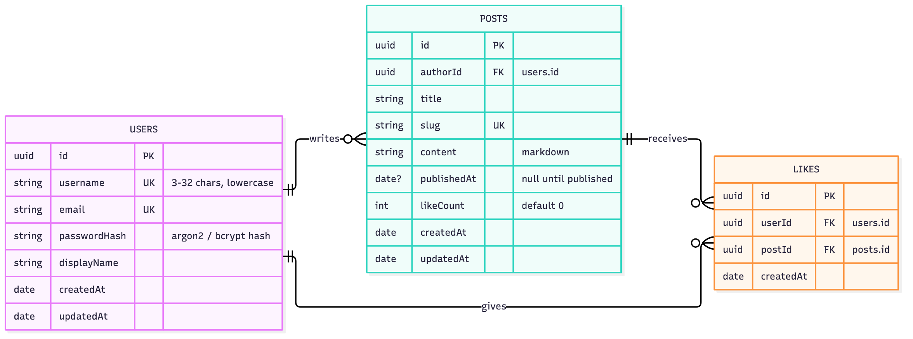

## Links

**GitHub Repository:**
[github.com/bobbymannino/comp3006](https://github.com/bobbymannino/comp3006)

**YouTube Video:** _TODO_

## Introduction

The project I have decided to pursue is making a blog. The product shall be
called **Bloggy**. The key priorities for this product are for it to work, have
a simple UX, and to be performant.

## Functional Requirements

| ID   | Requirement                                                                      |
| ---- | -------------------------------------------------------------------------------- |
| FR01 | Users can create an account                                                      |
| FR02 | Users can edit or delete their own accounts                                      |
| FR03 | Users can create/update/delete their own posts                                   |
| FR04 | Users can like their own and other peoples posts                                 |
| FR05 | Users can publish/unpublish their posts                                          |
| FR06 | The feed page will be live meaning new posts will be shown as they are published |
| FR07 | Any user can see all published posts                                             |

Table: Functional Requirements

Because I have prior knowledge in this specific field (web/API/database), I do
not have a priority list for the functional requirements. I'm confident I can
deliver all the features to a high standard on time.

## Target Audience

There is no specific demographic or user base in mind for this project, it is
designed for any user. A high priority for this project is **usability** and
**efficiency**. I would like the people who use this to know instantly without
any training or documentation how to use the product, as well as the product
feeling fast to use.

## Existing Products

There are several existing products that provide similar functionality to this
project. Some of the most popular ones include:

### [Blogger](https://www.blogger.com/)

{width=500px}

I have not used Blogger in over 5 years, but when I was using it for school it
got the job done. I will take inspiration from Blogger from a UX perspective,
keeping things simple and easy to understand was and is Bloggers best feature.

### [WordPress](https://wordpress.org/)

{width=500px}

I've never used WordPress before, but I know it has a massive market share
online. I also know it's more than a blog; it can do nearly anything, including
customizing the look. That customization is beyond this project's scope. I'll
use WordPress's complexity as a warning: there are many plugins, and while they
help, they can be overwhelming for someone wanting a straightforward public
blog.

### Existing Products Comparison

| Product   | Advantages                                                                   | Disadvantages                                                                        |
| --------- | ---------------------------------------------------------------------------- | ------------------------------------------------------------------------------------ |
| Blogger   | • Simple, easy to understand UI • Free • No setup or hosting needed    | • Limited customisation • Dated look • Few updates or new features             |
| WordPress | • Huge market share and community • Highly customisable • Many plugins | • Overwhelming for simple blogs • Plugins add complexity • Self-hosting needed |
| Bloggy    | • Simplest UI/UX • Performant                                             | • No extensions • Less features • Tiny userbase                                |

Table: Existing Products Comparison

## Architecture

### Architecture Topology

The product will follow a microservices architecture. There will be 4 Docker
images in this project:

- Nginx
- Database
- API
- Web UI

Each one runs independently and communicate with each other, for instance to
access the database you must use the API, to use the web UI you must use the
Nginx server. Putting the API and Web UI into their own containers allows you to
scale them independently and update them separately. If traffic becomes API
heavy you can scale those up, or if the user wants to host the API without
having any UI they can do that without any changes to the API container.

{width=500px}

> [!NOTE]
> Whilst it is possible to have multiple databases (read replicas) that is out
> of scope for this project so it will remain a single container.

### Nginx

This image will not contain much custom code. There will be a configuration file
to point specific paths to containers, a load balancer setup and that will be
it. Nginx comes with enough boilerplate to handle most of what I want to
achieve.

### Database

The database will be a MongoDB container. It will be used to store all the
persistent data from the blog, there will be no Redis or other cache layer as
that is out of scope for this project. The database container will only be
accessible to other containers on the same host machine, for this project it
will only be accessed by the API image.

### Web UI

The web UI image will be responsible for any interactions the user has. It will
provide the user with a simple, intuitive interface to interact with the blog.

### API

The API image is where the business logic of the blog is implemented. It will
handle all the requests from the web UI and the database. It will be able to
work without the web UI for people who want to build their own interfaces.

## Design Principles

My favorite principles are DRY and KISS, if you stick to these I believe your
product will always be better than if you do not. KISS (keep it simple, stupid)
can apply to both UI and the source code. Keeping your code simplified,
structured, and maintainable is key.

DRY (don't repeat yourself) is the act of not repeating any code. If the code is
used 2 or more times then you should be separating that part of the code. This
helps maintainability and can reduce bugs.

## Structures

### Database Structures

The database will hold three collections: `users`, `posts` and `likes`. A user
can write many posts, and a like links one user to one post, which gives the
many-to-many "users like posts" relationship needed for FR04.

Each collection's fields are shown below. MongoDB does not enforce foreign keys,
so the `FK` fields are references the API is responsible for keeping valid.

{width=500px}

- **Users** — `username` and `email` have unique indexes so two accounts cannot
  share either. Only a hash of the password is stored, never the password
  itself.
- **Posts** — `published` and `publishedAt` cover FR05; unpublished posts are
  only visible to their author. `likeCount` is a copy of the number of likes so
  the feed does not need to count the `likes` collection for every post.
- **Likes** — a compound unique index on `userId` and `postId` stops a user
  liking the same post twice. Unliking a post deletes the document.

> [!NOTE]
> When a user deletes their account (FR02) the API will also delete their posts,
> the likes on those posts and the likes they have given, so no documents are
> left pointing at a user that no longer exists.

### API Endpoints

| Method | Path               | Action                         | Requires Auth |
| ------ | ------------------ | ------------------------------ | ------------- |
| POST   | `/users`           | Create a new user              | N             |
| PUT    | `/users/:id`       | Update a user by id            | Y             |
| DELETE | `/users/:id`       | Delete a user                  | Y             |
| GET    | `/posts`           | Get all posts                  | N             |
| WS     | `/posts`           | Get all posts live             | N             |
| POST   | `/posts`           | Create a new post              | Y             |
| GET    | `/posts/:id`       | Get a post by id               | N             |
| PUT    | `/posts/:id`       | Update a post by id            | Y             |
| DELETE | `/posts/:id`       | Delete a post by id            | Y             |
| POST   | `/posts/:id/likes` | Create a new like              | Y             |
| DELETE | `/posts/:id/likes` | Delete a like by user and post | Y             |

Table: API Endpoints
