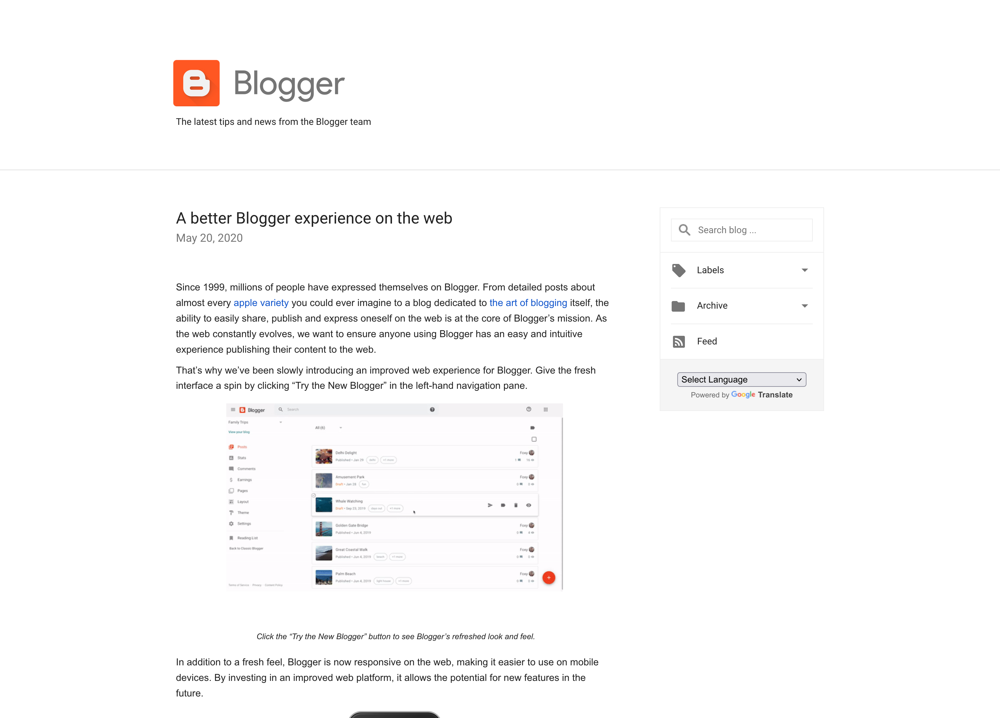
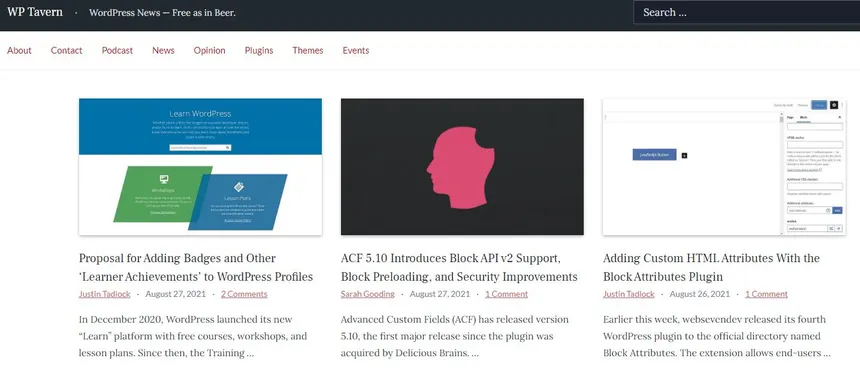
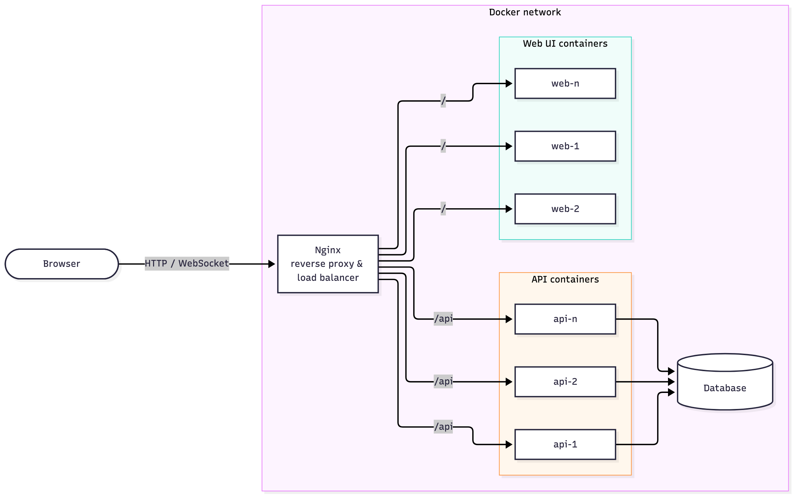
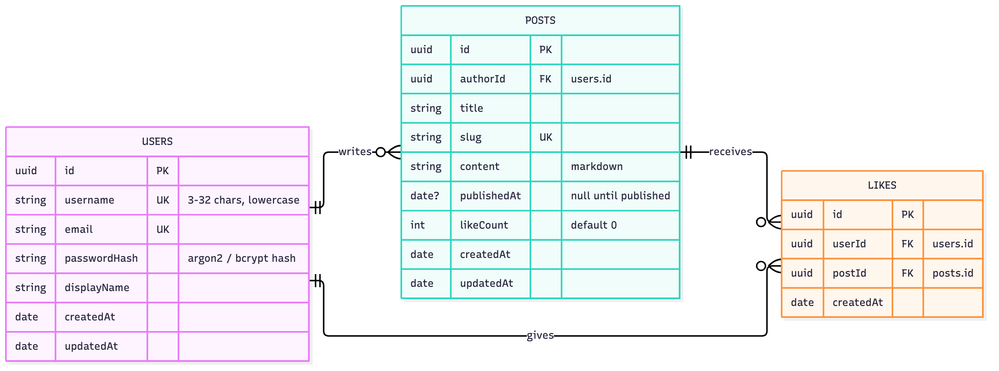

## Links

- **GitHub Repository:** <https://github.com/bobbymannino/comp3006>
- **YouTube Video:** <https://youtu.be/QGzrDtpBVmA>
- **API Docker Image:**
  <https://hub.docker.com/r/bobbymannino/comp3006-api/tags>
- **Web UI Docker Image:**
  <https://hub.docker.com/r/bobbymannino/comp3006-web-ui/tags>

## Introduction

The project I have decided to pursue is making a blog. The product shall be
called **Bloggy**. The key priorities for this product are for it to work, have
a simple UX, and to be performant.

## Functional Requirements

| ID   | Requirement                                                                      |
| ---- | -------------------------------------------------------------------------------- |
| FR01 | Users can create an account                                                      |
| FR02 | Users can edit or delete their own accounts                                      |
| FR03 | Users can create/update/delete their own posts                                   |
| FR04 | Users can like their own and other peoples posts                                 |
| FR05 | Users can publish/unpublish their posts                                          |
| FR06 | The feed page will be live meaning new posts will be shown as they are published |
| FR07 | Any user can see all published posts                                             |

Table: Functional Requirements

Because I have prior knowledge in this specific field (web/API/database), I do
not have a priority list for the functional requirements. I'm confident I can
deliver all the features to a high standard on time.

## Target Audience

There is no specific demographic or user base in mind for this project, it is
designed for any user. A high priority for this project is **usability** and
**efficiency**. I would like the people who use this to know instantly without
any training or documentation how to use the product, as well as the product
feeling fast to use.

## Existing Products

There are several existing products that provide similar functionality to this
project. Some of the most popular ones include:

### [Blogger](https://www.blogger.com/)

{width=500px}

I have not used Blogger in over 5 years, but when I was using it for school it
got the job done. I will take inspiration from Blogger from a UX perspective,
keeping things simple and easy to understand was and is Bloggers best feature.

### [WordPress](https://wordpress.org/)

{width=500px}

I've never used WordPress before, but I know it has a massive market share
online. I also know it's more than a blog; it can do nearly anything, including
customizing the look. That customization is beyond this project's scope. I'll
use WordPress's complexity as a warning: there are many plugins, and while they
help, they can be overwhelming for someone wanting a straightforward public
blog.

### Existing Products Comparison

| Product   | Advantages                                                                   | Disadvantages                                                                        |
| --------- | ---------------------------------------------------------------------------- | ------------------------------------------------------------------------------------ |
| Blogger   | • Simple, easy to understand UI<br>• Free<br>• No setup or hosting needed    | • Limited customisation<br>• Dated look<br>• Few updates or new features             |
| WordPress | • Huge market share and community<br>• Highly customisable<br>• Many plugins | • Overwhelming for simple blogs<br>• Plugins add complexity<br>• Self-hosting needed |
| Bloggy    | • Simplest UI/UX<br>• Performant                                             | • No extensions<br>• Less features<br>• Tiny userbase                                |

Table: Existing Products Comparison

## AI Declaration

In this project I have used AI. It has been used to create a huge amount of
seeding data for the database, this makes the app feel more realistic and less
bare. It has also been used to speed up the creation of tests. As I want to have
as many unit and integration tests as possible, I have used AI to add a large
amount of tests on top of mine. I have read through every single line of tests
that the AI created and ensured that I understood anything it added. I've also
slightly modified the output to more align with my style of coding, maintain
simplicity, and adhere closely to DRY[^dry].

## Architecture

### Architecture Topology

The product will follow a microservices architecture. There will be 4 Docker
images in this project:

- Nginx
- Database
- API
- Web UI

Each one runs independently and communicate with each other, for instance to
access the database you must use the API, to use the web UI you must use the
Nginx server. Putting the API and Web UI into their own containers allows you to
scale them independently and update them separately. If traffic becomes API
heavy you can scale those up, or if the user wants to host the API without
having any UI they can do that without any changes to the API container.

{width=500px}

> [!NOTE]
> Whilst it is possible to have multiple databases (read replicas) that is out
> of scope for this project so it will remain a single container.

### Nginx

This image will not contain much custom code. There will be a configuration file
to point specific paths to containers, a load balancer setup and that will be
it. Nginx comes with enough boilerplate to handle most of what I want to
achieve.

### Database

The database will be a MongoDB container. It will be used to store all the
persistent data from the blog, there will be no Redis or other cache layer as
that is out of scope for this project. The database container will only be
accessible to other containers on the same host machine, for this project it
will only be accessed by the API image.

### Web UI

The web UI image will be responsible for any interactions the user has. It will
provide the user with a simple, intuitive interface to interact with the blog.

### API

The API image is where the business logic of the blog is implemented. It will
handle all the requests from the web UI and the database. It will be able to
work without the web UI for people who want to build their own interfaces.

## Design Principles

My favorite principles are DRY and KISS, if you stick to these I believe your
product will always be better than if you do not. KISS (keep it simple, stupid)
can apply to both UI and the source code. Keeping your code simplified,
structured, and maintainable is key.

DRY (don't repeat yourself) is the act of not repeating any code. If the code is
used 2 or more times then you should be separating that part of the code. This
helps maintainability and can reduce bugs.

## Structures

### Database Structures

The database will hold four collections: `users`, `posts`, `likes` and
`sessions`. A user can write many posts, and a like links one user to one post,
which gives the many-to-many "users like posts" relationship needed for _FR04_.
A user can also have many sessions, one for each time they log in.

Each collection's fields are shown below. MongoDB does not enforce foreign keys,
so the `FK` fields are references the API is responsible for keeping valid.

{width=500px}

- **Users** — `username` and `email` have unique indexes so two accounts cannot
  share either. Only a hash of the password is stored, never the password
  itself.
- **Posts** — `published` and `publishedAt` cover FR05; unpublished posts are
  only visible to their author. `likeCount` is a copy of the number of likes so
  the feed does not need to count the `likes` collection for every post.
- **Likes** — a compound unique index on `userId` and `postId` stops a user
  liking the same post twice. Unliking a post deletes the document.
- **Sessions** — logging in creates a session and gives the user a random token
  to send as a bearer token. Only a SHA-256 hash of the token is stored, so a
  leaked database cannot be used to log in as anyone. Each session expires after
  3 days and a TTL index on `expiresAt` has MongoDB delete it once it has.

> [!NOTE]
> When a user deletes their account (FR02) the API will also delete their
> sessions, their posts, the likes on those posts and, the likes they have
> given, so no documents are left pointing at a user that no longer exists.

When using MongoDB there is a feature to have an _init_ scripts[^mongo-init].
This allows for 2 things that I have used:

- You can have a schema creation file to make sure that the database schema is
  created when the container starts.
- You can have a seed file to populate the database with some initial data.

MongoDB also has a useful _Time to Live_[^mongo-ttl] (TTL) feature that
automatically removes rows when a certain timestamp field reaches a certain
lifespan. This is used for removing expired sessions.

### API Endpoints

> [!NOTE]
> All paths will be prepended with `/api`.

| Method | Path               | Action                           | Requires Bearer |
| ------ | ------------------ | -------------------------------- | --------------- |
| PUT    | `/users/:id`       | Update a user by id              | Y               |
| DELETE | `/users/:id`       | Delete a user                    | Y               |
| GET    | `/posts`           | Get all posts                    | N               |
| WS     | `/posts`           | Get all posts live               | N               |
| POST   | `/posts`           | Create a new post                | Y               |
| GET    | `/posts/:id`       | Get a post by id                 | N               |
| PUT    | `/posts/:id`       | Update a post by id              | Y               |
| DELETE | `/posts/:id`       | Delete a post by id              | Y               |
| GET    | `/posts/:id/likes` | Check if the user liked a post   | Y               |
| POST   | `/posts/:id/likes` | Create a new like                | Y               |
| DELETE | `/posts/:id/likes` | Delete a like by user and post   | Y               |
| POST   | `/auth/login`      | Sign in with an existing account | N               |
| POST   | `/auth/signup`     | Create a new user account        | N               |

Table: API Endpoints

## Testing

### Unit Testing

This testing will be isolated to each image, for instance API testing will be
API specific and not interact with any other component (such as Nginx). This
will be useful for rapid testing and isolated test suites for scoped changes.

In the API image there are 4 different test scripts. Jest[^jest] runs the unit
tests in one of the scripts, this script requires nothing to be running to work
so it can be ran in CI. There is also a `:coverage` option for this which does
exactly the same but also lets you know about the code coverage for the tests.

The other script - just `test` and `test:coverage` - requires the database to be
running to work. That is because it interacts with functions and endpoints that
CRUD data. All data that is added is removed afterwords.

### Holistic Testing

Comprehensive testing will be carried out on the whole system together,
including every part, and will make sure they all function as intended. The
point of this is to ensure that all the components work together as expected.

This is done via Playwright[^playwright]. Playwright is testing framework
developed by Microsoft that allows you to write end-to-end tests for web
applications. In my case the database and API will both be running first, the
database does not need to be seeded for the tests to run. There are a series of
test files each oriented around different features, i.e. login, posts, account,
etc. Each one will have multiple stories where it's aim is to navigate pages,
complete actions and check results. This kind of testing follows the
AAA[^arrange-act-assert] testing method.

Code: Playwright login test

```ts
test("login with valid credentials", async ({ page, context }) => {
  // Arrange
  await page.goto("/login");

  // Act
  await page.locator("#username").fill(TEST_USER.username);
  await page.locator("#password").fill(TEST_USER.password);
  await page.locator("#login-button").click();
  await page.waitForURL("/");
  const cookies = await context.cookies();

  // Assert
  const token = cookies.find((c) => c.name === "token");
  if (!token) throw new Error("No token found");
  await expect(page).not.toHaveURL("/login");
});
```

### Test Coverage

The table below shows the test coverage for the API, this is done using
Jest[^jest]. The 4 files under the `api` directory shows zero percent coverage
but it is actually 100% covered, you can look in the repo[^repo] for proof. It
shows as zero because in the tests it is called from within the function (unit
style) instead of from the endpoint within the API (integration style).

Table: API Test Coverage

| File         | % Stmts | % Branch | % Funcs | % Lines | Uncovered Line #s |
| ------------ | ------- | -------- | ------- | ------- | ----------------- |
| All files    | 41.95   | 14.54    | 36.36   | 36.87   |                   |
| api          | 79.78   | 69.56    | 69.56   | 75.51   |                   |
| api.ts       | 0       | 100      | 0       | 0       | 23-60             |
| auth.ts      | 100     | 100      | 100     | 100     |                   |
| db-errors.ts | 100     | 100      | 100     | 100     |                   |
| db.ts        | 100     | 0        | 100     | 100     | 19                |
| env.ts       | 100     | 100      | 100     | 100     |                   |
| index.ts     | 85.71   | 100      | 100     | 85.71   | 14,22             |
| live.ts      | 0       | 0        | 0       | 0       | 7-42              |
| log.ts       | 100     | 100      | 100     | 100     |                   |
| models.ts    | 100     | 100      | 100     | 100     |                   |
| schemas.ts   | 100     | 100      | 100     | 100     |                   |
| sha.ts       | 100     | 100      | 100     | 100     |                   |
| text.ts      | 100     | 100      | 100     | 100     |                   |
| api/api      | 0       | 0        | 0       | 0       |                   |
| health.ts    | 0       | 0        | 0       | 0       | 7-12              |
| likes.ts     | 0       | 0        | 0       | 0       | 11-65             |
| posts.ts     | 0       | 0        | 0       | 0       | 10-151            |
| users.ts     | 0       | 0        | 0       | 0       | 10-155            |

## Continuous Integration/Deployment

Using GitHub's automation platform **Actions**[^gh-actions], I have continuous
testing along with automated Docker image creation. The image creation will only
apply to the **web UI and API** images since Nginx and MongoDB do not need to be
created. The test automation will only be unit tests since the integration tests
require the database or API to be running. I still run integration/regression
testing manually before every general release to ensure maximum coverage.

The latest version of the API and web UI images are available on Docker Hub:
<https://hub.docker.com/r/bobbymannino>.

## Evaluation

_TODO_

[^gh-actions]: <https://github.com/features/actions>

[^mongo-init]:
    <https://www.mongodb.com/docs/atlas/cli/current/atlas-cli-docker-compose#initialization>

[^jest]: <https://jestjs.io/>

[^repo]: <https://github.com/bobbymannino/comp3006>

[^playwright]: <https://playwright.dev/>

[^arrange-act-assert]:
    <https://automationpanda.com/2020/07/07/arrange-act-assert-a-pattern-for-writing-good-tests/>

[^mongo-ttl]: <https://www.mongodb.com/docs/manual/core/index-ttl/>

[^dry]: <https://en.wikipedia.org/wiki/Don't_repeat_yourself>
